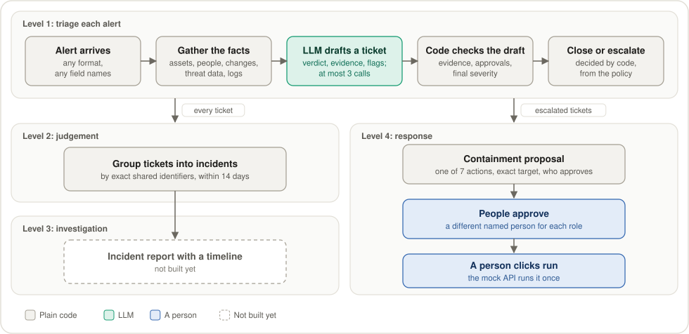

# Deloitte_Challenge_UAB_THE_HACK_2026
## Authors: 
- David
- Alex
- Francesco

AI triage for the SOC of Tarvia, a fictional retailer. Plain code gathers and checks the facts, the LLM judges, and a person decides. The LLM never approves or runs containment.

## How it works

### One alert, end to end
Two fixed rules can close well-known noise without the LLM, and a rule never escalates. Escalated tickets and incidents get an incident report (level 3).



### What the LLM sees
Code builds the same context for the same alert every time. Everything taken from the data goes in one block marked as untrusted, because attackers wrote some of it.


### How code checks the LLM's draft
The LLM only proposes. Wherever an answer can be checked, `build_ticket` and `_ask_llm` in `src/agent/triage.py` check it.


If triage fails, for example because the model is down, the ticket is `needs_more_info` and escalated, and it can never close.

### Who decides what
| Decision | Who makes it |
|---|---|
| What the alert is about, and which logs, assets and changes to fetch | Code |
| Closing well-known noise without the LLM | Code, only when every condition of a fixed rule holds (`src/agent/rules.py`) |
| Verdict, proposed ±1 adjustments, policy flags, the explanation | LLM, checked by code |
| Final severity | Code, from the policy matrix |
| Close or escalate, and to whom | Code, from the policy and the checked draft |
| Which alerts belong to one incident | Code, by exact shared identifiers |
| The incident report: story, scope, root cause | LLM writes it; code checks every timeline event and takes its time from the log |
| Which containment action, on what target, and who must approve | Code, from section 4 of the policy |
| Approving and running containment | People |

### How we build the agent
The analysis came first. Each trap it found became a rule in code with unit tests. The answer keys were written before any run, without seeing the agent's answers. Then each round changes one thing and is scored on the same 80 practice alerts.


A change stays only if it fixes more than it breaks and misses no new attack. The final 40 are never used to choose a version.

## Agent versions
Each version is a value of `PROMPT_VERSION` in `src/agent/prompts.py`. [docs/agent_versions.md](docs/agent_versions.md) has the full results by set. v6, in the code now, adds the two fixed rules and hasn't been scored yet.


Totals over the 80 practice alerts: the hard 40 and the normal-day 40. Severity counts the 55 alerts whose expected answer has one. They're marked against an answer key that AI drafted and no person has reviewed yet, on the same alerts used to choose the changes, so they're optimistic. One or two alerts either way can be chance. v2's missed and needless counts came from an older scorer, so they're left out. The 40 alerts kept back for the final score aren't in this grid.

## Setup
```bash
git clone https://github.com/dttdfr/DTT-UAB-The-Hack.git data
python3 -m venv .venv
source .venv/bin/activate
pip install -r requirements.txt
```
Create a `.env` file with your own key:
```text
LLM_API_KEY=uth-your_team_key
LLM_BASE_URL=https://dcc-llm-gw.uab.cat/uabthehack/v1
LLM_MODEL=ornith
LLM_ENABLE_THINKING=false
MOCK_API_URL=http://localhost:8000
```
With `LLM_ENABLE_THINKING=false`, `ornith` answers in seconds. Without it, the model reasons first and an alert takes minutes.
The UI also needs Node 22 or newer (on a Mac, `brew install node`):
```bash
cd ui && npm install
```

## Run
Mock API:
```bash
uvicorn --app-dir data/06_herramientas mock_soc_api:app --port 8000
```
Backend, with the real agent (needs the mock API running and the LLM key in `.env`):
```bash
TRIAGE_MODE=real uvicorn src.app.main:app --port 8001
```
Backend with fictional example tickets from `contracts/examples/` (no mock API or LLM key needed):
```bash
uvicorn src.app.main:app --port 8001
```
UI, at http://localhost:5173:
```bash
cd ui && npm run dev
```
Backend with an empty queue that holds only the alerts you import, using its own database:
```bash
TRIAGE_MODE=real APP_SAMPLE=none APP_DB_PATH=runs/final.sqlite3 uvicorn src.app.main:app --port 8001
```
The import button takes JSON, JSONL or CSV, with other field names too. Save an Excel file as CSV first.

Test the LLM:
```bash
python scripts/test_llm.py
```
Tests:
```bash
pytest
```

## Practice exam
`scripts/exam.py` triages alerts and scores them against `eval/labels.csv`. It starts the mock API if needed, and a run that stops can be repeated without redoing anything. On each laptop:
```bash
python3 scripts/exam.py setup
```
```bash
python3 scripts/exam.py run --laptop 1 --laptops 3
```
```bash
python3 scripts/exam.py pack --laptop 1
```
Change `--laptop` to 2 and 3 on the others, and send their zips to one laptop. There:
```bash
python3 scripts/exam.py merge runs/exam_FOLDER_laptop2.zip runs/exam_FOLDER_laptop3.zip
```
```bash
python3 scripts/exam.py score
```
All laptops must be on the same commit and model. `--set` chooses the alerts: `exam` is 40 hard cases and `normal` is 40 in a normal day's mix, both with answers, `scored` is both, `final` is 40 more with answers kept for the honest final score (never tune on them), `extra` is the other 62 with no answers, and `all` is everything. `--workers 6` runs six alerts at once on a provider with no limits. `score --set normal` marks one set.

Each run also keeps a call log in `calls/`: for every alert, the prompts sent, the model's raw answers and reasoning, and what our code changed. To read one:
```bash
python3 scripts/exam.py explain ALR-20261007-011785
```
Add `--prompt` to see the prompts. The app keeps the same for real runs in `runs/app_calls/`. These files hold alert and log text, which may contain attackers' instructions, so read them as data. `runs/` is not in git, and `pack` includes the logs.

Since v8 three things are on by default, chosen by the night of 8 Nov (`docs/agent_versions.md`). Setting the variable switches one back for an experiment, and its tickets go to their own `runs/` folder:
- JSON mode is off, because with reasoning on it often returned only `{}`. `LLM_JSON_MODE=1` turns it on.
- A phishing alert's context holds the rest of the campaign: other copies of the email, visits to the phishing site and sign-ins from its IP. `AGENT_CAMPAIGN=0` turns it off.
- The answer checklist is repeated at the end of the prompt. `AGENT_FORMAT_REMINDER=0` turns it off.
- `AGENT_LESSONS_FILE=path.json` adds reviewed general lessons, checked by `src/agent/lessons.py`, which refuses IDs, IPs, accounts, hosts, URLs and anything about approving containment.

`scripts/night_loop.py round NAME --no-json-mode --campaign --reminder` runs the 80 scored alerts with all three (leave a flag out to switch that one off) and adds a row to `runs/night/summary.md`. `night_loop.py mistakes FOLDER` lists the exam set's mistakes as structured fields only, with no alert text.

Analysis notebook:
```bash
jupyter notebook analysis/explore.ipynb
```

## Incidents (level 2)
`src/agent/correlate.py` groups the alerts of one attack into a single incident ticket, with plain code. Each link records what the two alerts share, such as the same account, sender or event, and the Incidentes page in the side menu shows it. To group a folder of tickets from the exam:
```bash
python -m src.agent.correlate runs/v3-ornith-nothink
```
To score with alerts marked by their incident's ticket:
```bash
python3 scripts/exam.py score --grouped
```

## Investigation (level 3)
On an escalated incident or ticket, "Investigar" on the Incidentes page, or the link on one of its alerts, opens the incident report. `src/agent/investigate.py` gathers the evidence with plain code and the LLM writes the analysis. Code checks every timeline event against what it retrieved and takes each time from the log. The report's tabs say who wrote each part, and its "Contención" tab uses the same approvals as level 4. From the command line (needs the mock API and the LLM key):
```bash
python scripts/investigate.py ALR-20261007-011785 ALR-20261008-011789
```

## Containment (level 4)
On an escalated ticket, the alert page's "Política y acciones" tab lists the containment actions built from the LLM's suggestions. `src/policy/containment.py` maps each one onto the mock's 7 actions, finds the exact target and decides who must approve, with plain code. Each required role is approved by a different named person, and only then does "Ejecutar en la API simulada" call the mock, once. OT actions are never proposed. The page also shows the mock's containment log.

## Folders
```text
analysis/     data analysis notebook
contracts/    data formats
src/tools/    api client, log search
src/policy/   severity, approvals
src/agent/    llm, triage
src/app/      backend
ui/           frontend (react, css)
eval/         labels, scoring
docs/         notes, one-pager, demo script
scripts/      quick tests
data/         deloitte dataset (not in git)
```

## Docs
- [Overview](docs/overview.md): what we're building
- [Decisions](docs/decisions.md): what's decided and what's open
- [Data traps](docs/data_traps.md): what the analysis found in the data
- [Agent versions](docs/agent_versions.md): each version of the agent and its exam results
- [AGENTS.md](AGENTS.md): rules for coding agents
