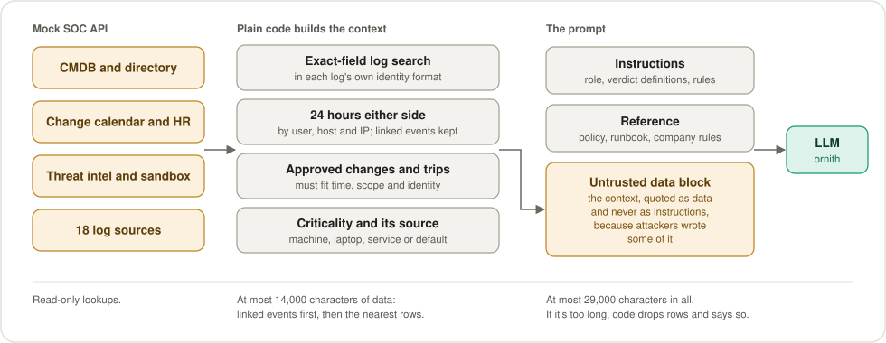
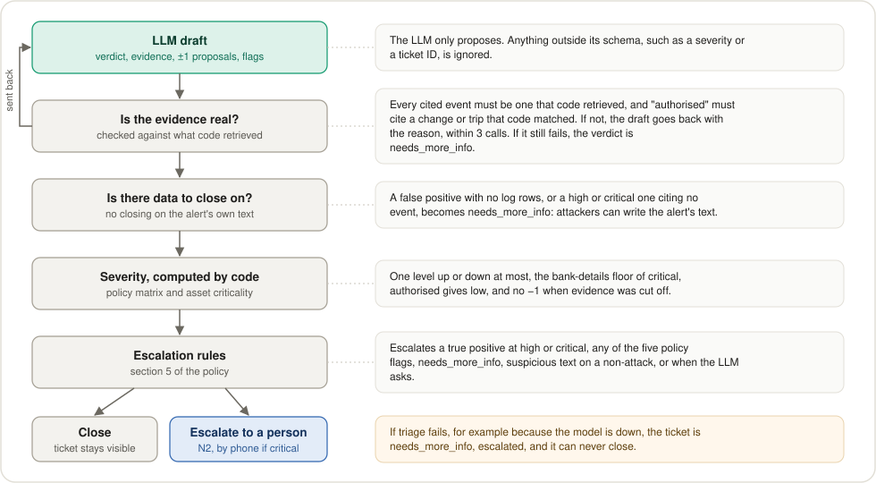
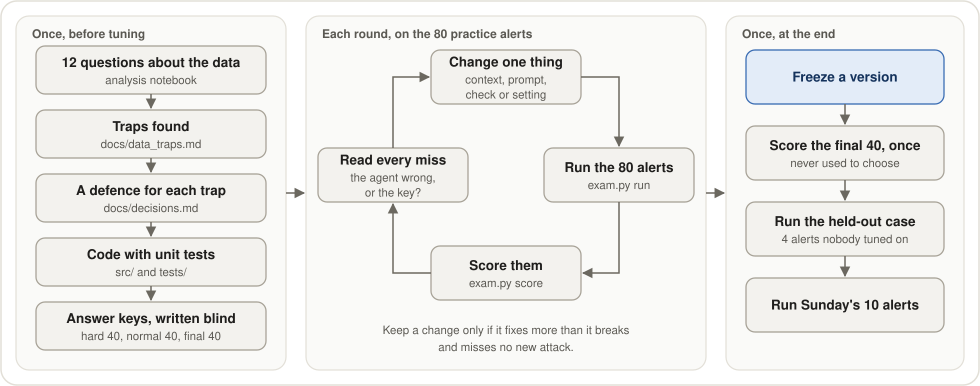
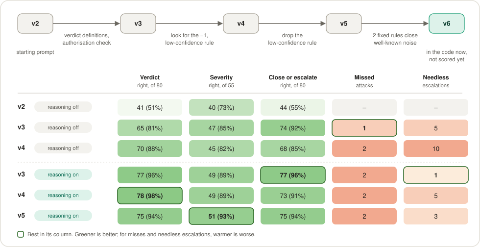

# Tarvia SOC Triage Agent

By David, Alex and Francesco, for Deloitte's challenge at UAB The Hack 2026.

An AI agent that triages security alerts for the SOC of Tarvia, a fictional retailer. Given an alert, it looks up the facts, works out what happened, and writes a ticket with its evidence. Then it proposes closing the alert or escalating it, and a person decides.

**Plain code gathers and checks the facts, the LLM judges, and a person decides. The LLM never approves or runs containment.**

## At a glance
| | |
|---|---|
| Levels built | All 4: triage, judgement (grouping into incidents), investigation (incident reports), response (containment) |
| Fully right on 80 practice alerts (v8) | 77 and 76 in two runs: verdict, severity and escalation all match the key |
| Attacks missed on those 80 (v8) | 0 in both runs |
| Handled with no LLM | 43% of all alerts, by 2 fixed rules, in about a second each |
| Speed | About 2.5 minutes per model call, with reasoning on |
| Code tests | 857 unit tests, plus 19 for the UI logic |

These practice scores are optimistic: see [What it doesn't solve](#what-it-doesnt-solve).

## What the AI decides, what a person decides
| Decision | Who makes it |
|---|---|
| What the alert is about, and which logs, assets and changes to fetch, including the rest of a phishing campaign | Code |
<<<<<<< HEAD
| Closing well-known noise without the LLM | Code, only when every condition of a fixed rule holds (`src/agent/rules.py`) |
| Whether a closed ticket skips human review, with `AUTO_TRIAGE=1` | Code, only when every condition holds (`src/policy/auto_close.py`) |
=======
| Proposing to close well-known noise, without the LLM | Code, only when every condition of a fixed rule holds (`src/agent/rules.py`) |
>>>>>>> 589125e (Update README.md)
| Verdict, proposed ±1 adjustments, policy flags, the explanation | LLM, checked by code |
| Final severity | Code, from the policy matrix |
| Proposing close or escalate, and to whom | Code, from the policy and the checked draft |
| Accepting or changing that proposal | A person, by name, on the ticket page. A change needs a reason |
| Which alerts belong to one incident | Code, by exact shared identifiers |
| The incident report: story, scope, root cause | LLM writes it; code checks every timeline event and takes its time from the log |
| Which containment action, on what target, and who must approve | Code, from section 4 of the policy |
| Approving and running containment | People |

## What makes it different
- **It treats the data as untrusted.** Attackers wrote some of it, so nothing in an alert or a log is ever an instruction. Suspicious text on anything but an attack sends the ticket to a person.
- **Code checks every answer it can.** Cited events must exist in the logs, approvals must match a real change or trip, and code computes the final severity from Tarvia's policy.
- **When in doubt, it asks a person.** With no data to close on, or if the model is down, the ticket is escalated and code never proposes closing it.
- **It sees a whole phishing campaign.** Code fetches what happened to the other recipients, which caught 2 attacks every earlier version missed.

## What it doesn't solve
- **The scores measure agreement, not accuracy.** Claude drafted the answer key, and we reviewed only the 20 of its 120 answers it was least sure of, before seeing any results. We changed none. The 80 practice alerts were also used to tune the agent.
- **The model varies.** The same version run twice differs by a few alerts in 80.
- **It still makes mistakes.** For example, a vendor VPN session inside its approved change goes to a person as `needs_more_info`. In v8's two runs, its mistakes never closed an attack.
- **It's slow.** Reasoning on takes minutes per alert. Reasoning off takes seconds but scores clearly worse.
- **The fixed rules cover only two kinds of noise,** and a ticket closed by a rule has no injection flags, because no model reads it.
- **Containment runs only on the simulated API.** Approvers are typed names, not signed-in users, and the console only answers the local machine.
- **It has only seen Deloitte's fictional data,** never a real SOC.
- **Automatic triage has limits of its own,** such as an auto-close hiding a rule mistake, and it's off by default: see [Automatic triage](#automatic-triage-levels-1-to-3).

## Try it
The interface runs with no LLM key, using fictional example results, but it needs Deloitte's dataset for its alerts (Python, and Node 22 or newer):
```bash
git clone https://github.com/dttdfr/DTT-UAB-The-Hack.git data
```
```bash
python3 -m venv .venv && source .venv/bin/activate && pip install -r requirements.txt
```
```bash
uvicorn src.app.main:app --port 8001
```
In a second terminal, then open http://localhost:5173:
```bash
cd ui && npm install && npm run dev
```
The real agent also needs the mock API and an LLM key: see [Setup](#setup).

## How it works

### One alert, end to end
Two fixed rules can propose closing well-known noise without the LLM, and a rule never escalates. Escalated tickets and incidents get an incident report (level 3).


### What the LLM sees
Code builds the same context for the same alert every time. For a phishing alert it also fetches the rest of the campaign: other copies of the email, visits to the site and sign-ins from the IPs that served it. Everything taken from the data goes in one block marked as untrusted, because attackers wrote some of it. The answer checklist comes again after that block.



### How code checks the LLM's draft
The LLM only proposes. Wherever an answer can be checked, `build_ticket` and `_ask_llm` in `src/agent/triage.py` check it.



If triage fails, for example because the model is down, the ticket is `needs_more_info` and escalated, and code never proposes closing it.

### How we build the agent
The analysis came first. Each trap it found became a rule in code with unit tests. Claude drafted the answer keys before any run, without seeing the agent's answers, and we reviewed the 20 answers it was least sure of, changing none. Then each round changes one thing and is scored on the same 80 practice alerts, and on the 31 look-alike alerts among them, where one detail flips the answer.



A change stays only if it fixes more than it breaks, misses no new attack and doesn't make the normal 40 worse. On the night of 8 Nov, `scripts/night_loop.py` ran eight rounds this way. Lessons could come only from the hard 40's misses, so the normal 40 stayed an honest check. The final 40 are never used to choose a version.

## Agent versions
Each version is a value of `PROMPT_VERSION` in `src/agent/prompts.py`. [docs/agent_versions.md](docs/agent_versions.md) has the full results by set, the look-alike pairs and the night's eight rounds. v8 is the default now: v7 with JSON mode off, the rest of a phishing campaign in the context, and the answer checklist repeated at the end of the prompt.



Totals over the 80 practice alerts: the hard 40 and the normal-day 40. Severity counts the 55 alerts whose expected answer has one, and fully right means verdict, severity and escalation all match. They're marked against an answer key that Claude drafted, on the same alerts used to choose the changes, so they're optimistic. David, Alex and Francesco reviewed the 20 of its 120 answers it was least sure of, before seeing any results, and changed none. The other 100 aren't reviewed, so the scores measure agreement with the key, not the truth. v2's missed and needless counts came from an older scorer, so they're left out. The 40 alerts kept back for the final score aren't in this grid.

What the night showed:
- **The campaign context fixes the 2 attacks every earlier version missed:** phishing reports that only matter because a colleague gave away a login. No round with it missed an attack, on either set.
- **The same version run twice differs by a few alerts.** v7 got 74 fully right, then 72. v8's 77 and 76 are about that much better, so that gain could be chance. The gain on missed attacks is larger than the noise.
- **JSON mode off stops empty answers.** With it on, reasoning sometimes ended in just `{}`, which cost a full retry. With it off there were none.
- **v6's fixed rules don't change accuracy:** they changed no answer on the 80. They're kept because they close 43% of all alerts in about a second each, with no model call.
- **A written lesson didn't help, so it was dropped.** The model can't judge a campaign it can't see; code had to fetch it.

## Setup
```bash
git clone https://github.com/dttdfr/DTT-UAB-The-Hack.git data
python3 -m venv .venv
source .venv/bin/activate
pip install -r requirements.txt
```
Create a `.env` file with your own key:
```text
LLM_API_KEY=uth-your_team_key
LLM_BASE_URL=https://dcc-llm-gw.uab.cat/uabthehack/v1
LLM_MODEL=ornith
MOCK_API_URL=http://localhost:8000
```
The model reasons first by default, as in all of v8's results, so an alert takes minutes. Adding `LLM_ENABLE_THINKING=false` makes it answer in seconds, with worse results.

The UI also needs Node 22 or newer (on a Mac, `brew install node`):
```bash
cd ui && npm install
```

## Run
Mock API:
```bash
uvicorn --app-dir data/06_herramientas mock_soc_api:app --port 8000
```
Backend, with the real agent (needs the mock API running and the LLM key in `.env`):
```bash
TRIAGE_MODE=real uvicorn src.app.main:app --port 8001
```
Backend with fictional example tickets from `contracts/examples/` (no mock API or LLM key needed):
```bash
uvicorn src.app.main:app --port 8001
```
UI, at http://localhost:5173:
```bash
cd ui && npm run dev
```
Backend with an empty queue that holds only the alerts you import, using its own database:
```bash
TRIAGE_MODE=real APP_SAMPLE=none APP_DB_PATH=runs/final.sqlite3 uvicorn src.app.main:app --port 8001
```
The import button takes JSON, JSONL or CSV, with other field names too. Save an Excel file as CSV first.

Test the LLM:
```bash
python scripts/test_llm.py
```
Tests:
```bash
pytest
```
UI logic tests, from `ui/`:
```bash
node --test "src/**/*.test.js"
```

## Automatic triage (levels 1 to 3)
Off by default, so the queue works by clicking. To turn it on (needs the mock API and the LLM key in `.env`):
```bash
TRIAGE_MODE=real AUTO_TRIAGE=1 uvicorn src.app.main:app --port 8001
```
The worker starts with the server and takes the alerts with no ticket, including the ones you import: fixed rules first, then the LLM by rule severity, asset criticality and earliest deadline. To start, pause and stop it, use the buttons on the Operación page in the side menu. Stopping finishes the alert in progress and starts no more. With `AUTO_TRIAGE=0` the buttons are off and the routes refuse, so restart the server to turn it on.

| Variable | Default | What it does |
|---|---|---|
| `AUTO_TRIAGE` | `0` | `1` turns on the worker, automatic grouping and auto-close. Example tickets never auto-close. |
| `AUTO_INVESTIGATE` | `0` | `1` also writes a report for each escalation, critical first. Needs `AUTO_TRIAGE=1`. |
| `AUTO_TRIAGE_MAX_CALLS_PER_RUN` | `100` | LLM calls from one start of the worker, reports included. It stops there. |
| `AUTO_TRIAGE_MAX_CALLS_PER_MINUTE` | `30` | LLM calls per minute. It waits rather than stops. |
| `AUTO_TRIAGE_PACE_SECONDS` | `LLM_PACE_SECONDS`, or `2` | Pause between alerts that may call the LLM. |
| `AUTO_TRIAGE_MAX_FAILURES` | `3` | Failures in a row before it stops. It also stops when the LLM runs out of quota. |
| `AUTO_GROUP_SECONDS` | `30` | Grouping runs at most this often, and only with new tickets. |
| `AUTO_CLOSE_SAMPLE_PERCENT` | `5` | Share of auto-closed tickets shown at random for review. |

A ticket the code already closed skips human review only if its final severity is informational or low, its verdict isn't `needs_more_info`, it has no policy or injection flags, the evidence and authorisation checks passed, and nothing about it touches the OT network (`src/policy/auto_close.py`). Everything else waits for a person, and a person can reopen any auto-closed ticket. The LLM never decides close or escalate on its own, never approves and never runs anything, and level 4 stays human: every containment action needs a person's approval and a person's click.

SLA targets are in `src/policy/sla.py`. The clock starts when an alert enters the app and stops when its ticket is created.

What this doesn't solve:
- An auto-close can hide a rule mistake, or a model misled by text in the data. Only the sample and the per-rule counts make that visible.
- The LLM budget caps coverage. Alerts that don't fit stay for a person and show as at risk or breached, and they're never closed because of the delay.
- The SLA is measured in the app, not from the real SIEM arrival time.
- Notifications stay inside the app. Nothing reaches the SOC lead, the CISO or on-call N2 outside the console, so a breach at night goes unseen until someone opens it. The system calls nobody: a person confirms the N2 call or handover.

## Practice exam
`scripts/exam.py` triages alerts and scores them against `eval/labels.csv`. It starts the mock API if needed, and a run that stops can be repeated without redoing anything. On each laptop:
```bash
python3 scripts/exam.py setup
```
```bash
python3 scripts/exam.py run --laptop 1 --laptops 3
```
```bash
python3 scripts/exam.py pack --laptop 1
```
Change `--laptop` to 2 and 3 on the others, and send their zips to one laptop. There:
```bash
python3 scripts/exam.py merge runs/exam_FOLDER_laptop2.zip runs/exam_FOLDER_laptop3.zip
```
```bash
python3 scripts/exam.py score
```
All laptops must be on the same commit and model. `--set` chooses the alerts: `exam` is 40 hard cases and `normal` is 40 in a normal day's mix, both with answers, `scored` is both, `pairs` is the 31 look-alike alerts within those 80, where one detail flips the answer, `final` is 40 more with answers kept for the honest final score (never tune on them), `extra` is the other 62 with no answers, and `all` is everything. `--workers 6` runs six alerts at once on a provider with no limits. `score --set normal` marks one set.

Each run also keeps a call log in `calls/`: for every alert, the prompts sent, the model's raw answers and reasoning, and what our code changed. To read one:
```bash
python3 scripts/exam.py explain ALR-20261007-011785
```
Add `--prompt` to see the prompts. The app keeps the same for real runs in `runs/app_calls/`. These files hold alert and log text, which may contain attackers' instructions, so read them as data. `runs/` is not in git, and `pack` includes the logs.

Since v8 three things are on by default, chosen by the night of 8 Nov (`docs/agent_versions.md`). Setting the variable switches one back for an experiment, and its tickets go to their own `runs/` folder:
- JSON mode is off, because with reasoning on it often returned only `{}`. `LLM_JSON_MODE=1` turns it on.
- A phishing alert's context holds the rest of the campaign: other copies of the email, visits to the phishing site and sign-ins from its IP. `AGENT_CAMPAIGN=0` turns it off.
- The answer checklist is repeated at the end of the prompt. `AGENT_FORMAT_REMINDER=0` turns it off.

`AGENT_LESSONS_FILE=path.json` adds reviewed general lessons, off unless it's set. `src/agent/lessons.py` checks them and refuses IDs, IPs, accounts, hosts, URLs and anything about approving containment.

`scripts/night_loop.py round NAME --no-json-mode --campaign --reminder` runs the 80 scored alerts with all three (leave a flag out to switch that one off) and adds a row to `runs/night/summary.md`. `night_loop.py mistakes FOLDER` lists the exam set's mistakes as structured fields only, with no alert text.

Analysis notebook:
```bash
jupyter notebook analysis/explore.ipynb
```

## Incidents (level 2)
`src/agent/correlate.py` groups the alerts of one attack into a single incident ticket, with plain code. Each link records what the two alerts share, such as the same account, sender or event, and the Incidentes page in the side menu shows it. To group a folder of tickets from the exam:
```bash
python -m src.agent.correlate runs/v3-ornith-nothink
```
To score with alerts marked by their incident's ticket:
```bash
python3 scripts/exam.py score --grouped
```

## Investigation (level 3)
On an escalated incident or ticket, "Investigar" on the Incidentes page, or the link on one of its alerts, opens the incident report. `src/agent/investigate.py` gathers the evidence with plain code and the LLM writes the analysis. Code checks every timeline event against what it retrieved and takes each time from the log. The report's tabs say who wrote each part, and its "Contención" tab uses the same approvals as level 4. From the command line (needs the mock API and the LLM key):
```bash
python scripts/investigate.py ALR-20261007-011785 ALR-20261008-011789
```

## Containment (level 4)
On an escalated ticket, the alert page's "Política y acciones" tab lists the containment actions built from the LLM's suggestions. `src/policy/containment.py` maps each one onto the mock's 7 actions, finds the exact target and decides who must approve, with plain code. Each required role is approved by a different named person, and only then does "Ejecutar en la API simulada" call the mock, once. OT actions are never proposed. The page also shows the mock's containment log.

## Folders
```text
analysis/     data analysis notebook
contracts/    data formats
src/tools/    api client, log search
src/policy/   severity, approvals, sla, auto-close
src/agent/    llm, triage, fixed rules, grouping, incident reports
src/app/      backend
ui/           frontend (react, css)
eval/         labels, scoring
docs/         notes, figures, results of each version
scripts/      practice exam, night rounds, quick tests
data/         deloitte dataset (not in git)
```

## Docs
- [Overview](docs/overview.md): what we're building
- [Decisions](docs/decisions.md): what's decided and what's open
- [Data traps](docs/data_traps.md): what the analysis found in the data
- [Agent versions](docs/agent_versions.md): each version of the agent and its exam results
- [AGENTS.md](AGENTS.md): rules for coding agents
